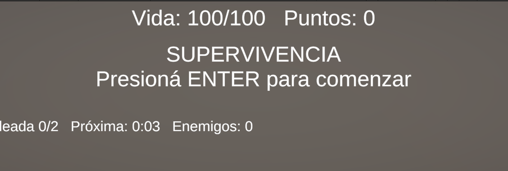
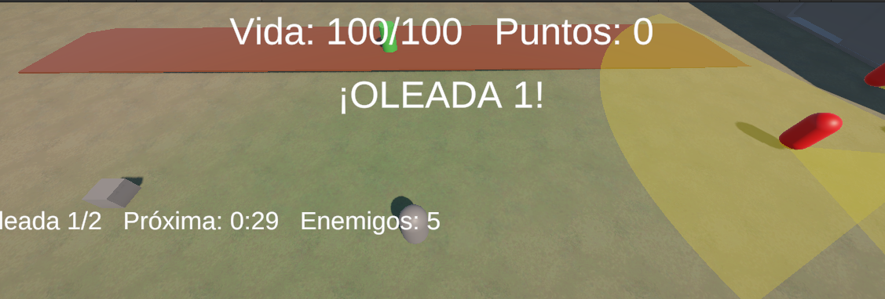

# CubeGame – Supervivencia por Oleadas (TP2 Recuperatorio)

**Programación de Videojuegos I – 2026**

| Dato | Valor |
|---|---|
| Estudiante | FARFÁN, Esteban Josué |
| DNI | 46525367 |
| Versión de Unity | 6000.5.7f1 |
| Repositorio | FarfanEstebanJosue_TP2_Recuperatorio |

## Descripción

Shooter 3D con vista desde arriba sobre un terreno con desniveles y texturas. Cada 30 segundos aparece una oleada de enemigos alrededor del jugador, a distancia. Los enemigos patrullan con un campo de visión visible; si el jugador entra en él (o les dispara), lo persiguen y lo atacan. Para ganar hay que sobrevivir 5 oleadas. Cada enemigo eliminado suma puntos.

El mapa tiene un área médica cerrada con una puerta que se abre desde una terminal de datos. Adentro está la Estación de Curación.

## Origen del proyecto

Este recuperatorio se desarrolló a partir del proyecto de la **primera entrega del TP1** (un plataformero donde había que sobrevivir a objetos que caían y llevar una caja a la meta). Se creó un proyecto y un repositorio nuevos, y se reutilizaron y adaptaron partes del anterior:

| Elemento del primer proyecto | Qué se hizo |
|---|---|
| `CamaraSeguimiento` | Se reutilizó y se mejoró: ahora se adelanta hacia donde apunta el mouse. |
| `PlayerController` | Se usó como base: se agregó correr, apuntar con el mouse, Raycast de suelo con LayerMask y el sistema de salud. |
| `PowerUp` | Se adaptó: antes daba velocidad, ahora recupera vida. |
| `GameManager` | Se rehízo como Singleton con máquina de estados, pausa y eventos. |
| Jugador, plataformas y escenario | Se reutilizaron y se integraron con el nuevo terreno. |
| Obstáculos que caen, caja y meta | Se quitaron, porque el juego pasó a ser de supervivencia por oleadas. |
Cómo agregarlo con nano

## Controles

| Tecla | Acción |
|---|---|
| WASD | Moverse |
| Shift | Correr |
| Mouse | Apuntar (el personaje mira al mouse y la cámara se adelanta) |
| Click izquierdo (mantener) | Disparar |
| Click derecho | Arma aturdidora |
| Espacio | Saltar |
| E | Interactuar (terminal y puerta) |
| ESC / P | Pausa |
| Enter | Comenzar |
| R | Reiniciar (en Victoria / Derrota) |

## Sistemas implementados

### Raycast y LayerMask
- **Chequeo de suelo:** `PlayerController` lanza un rayo hacia abajo filtrando solo la capa `Ground`. Solo se puede saltar si el rayo impacta.
- **Interacción a distancia:** `InteraccionRaycast` lanza un rayo frontal filtrando solo la capa `Interactable` para activar la terminal y abrir la puerta (interfaz `IInteractuable`). Además detecta objetos pegados al jugador con `OverlapSphere` (también filtrado por LayerMask), para poder abrir la puerta estando de espaldas.
- **Disparo:** `ArmaJugador` y `ArmaAturdidora` usan Raycast con LayerMask (`Default`, `Ground`, `Enemy`).
- **Sin autodaño:** ninguna máscara incluye la capa `Player`.

### IA con NavMesh
- NavMesh horneado sobre el terreno con `NavMeshSurface` (solo capa `Ground`).
- Las paredes del área médica y la puerta usan `NavMeshObstacle` con *Carve*: los enemigos las rodean y solo entran si la puerta está abierta.
- `Enemigo` usa `NavMeshAgent` con una máquina de estados: **Patrulla → Persecución → Ataque** (+ **Aturdido**).
- Campo de visión visible en el piso (cono): amarillo patrullando, rojo persiguiendo, celeste aturdido.

### Salud, daño y puntuación
- `PlayerHealth` con tiempo de inmunidad entre golpes (el contacto no quita toda la vida en un frame).
- Puntos por cada enemigo eliminado y por descargar datos de la terminal (+10).
- `PowerUp`: ítem que recupera vida y reaparece después de un tiempo.

### GameManager
Singleton con estados `Inicio, Jugando, Pausa, Victoria, Derrota`. La pausa congela el tiempo (`Time.timeScale = 0`). No contiene lógica del jugador ni de los enemigos: escucha eventos de `PlayerHealth` y de `SpawnerOleadas`, y notifica por consola y HUD el estado, la vida y los puntos.

### Setup automático
`PlayerSetup` y `EnemySetup` configuran solos capas, tag, Rigidbody, colliders, NavMeshAgent, scripts y LayerMask.

### Terreno
Modelado con Terrain Tool: desniveles, rampas y varias texturas pintadas.

## Estación de Curación
`EstacionCuracion`, ubicada dentro del área médica:
- Detecta la presencia del jugador dentro de su Collider.
- Cura de forma **progresiva**: +10 HP cada 1,5 s.
- **Carga máxima** de 50 HP; al agotarse entra en **recarga por 10 s**.
- **Feedback:** durante la recarga apaga la luz y las partículas, la plataforma pasa de verde a rojo y se muestra **"Estación en Recarga"** en consola y HUD.

## Requisitos opcionales elegidos
1. **Opción A – Arma por Raycast (`ArmaAturdidora`):** click derecho; si el rayo impacta un enemigo lo paraliza 3 s (detiene el NavMeshAgent y cambia su color).
2. **Opción D – Zona de barro (`ZonaBarro`):** trigger que reduce la velocidad del jugador al 40% al entrar y la restablece al salir.
3. **Opción E – Generador temporizado (`SpawnerOleadas`):** cada 30 s crea una oleada de enemigos en un anillo alrededor del jugador, sobre el NavMesh, con más enemigos en cada oleada.

## Correcciones aplicadas respecto a la primera entrega
- **Chequeo de suelo sin LayerMask:** el Raycast usaba `~0` (todas las capas). Ahora filtra solo `Ground`.
- **Daño instantáneo:** antes se perdía al primer golpe. Ahora hay sistema de salud con inmunidad entre golpes.
- **GameManager sin estados:** solo tenía un temporizador y un booleano. Ahora tiene máquina de estados, pausa y eventos.
- **Lógica acoplada:** el jugador llamaba directamente a `GameManager.Perder()`. Ahora la muerte pasa por `PlayerHealth`, que avisa por evento.
- **Logs en cada frame:** se eliminaron los `Debug.Log` dentro de `OnTriggerStay`.
- **Rediseño:** de plataformero con objetos que caen a supervivencia por oleadas con IA en NavMesh, reutilizando la cámara, el jugador, el power-up y el escenario.

## Capturas

